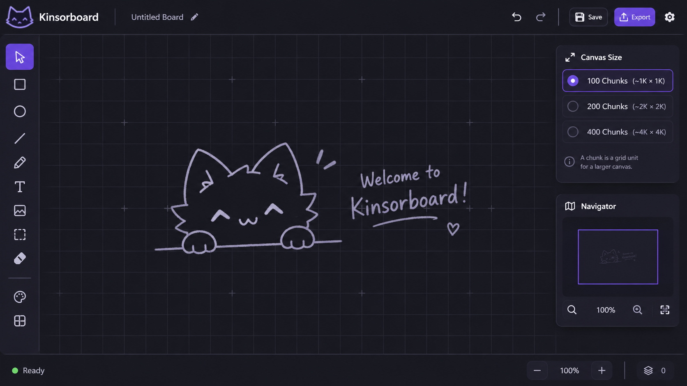

# Kinsorboard

**Version:** `0.1.0-alpha.9`  
**Status:** Active Development (MVP Phase)

Легковесный, быстрый и масштабируемый интерактивный whiteboard для заметок, схем и рисования.

---

## 🎯 Концепция и цель MVP

Создать производительную рабочую доску без лишнего оверхеда с заделом на кроссплатформенность (Web -> Electron / Desktop / Mobile) и будущий мультиплеер.

### Ключевые фичи MVP:
- **Гибридный рендеринг:** UI-оболочка на React, сам холст на нативном HTML5 Canvas (2D API) для стабильных 60 FPS.
- **Чанковая система координат:** Вместо хаотичной бесконечности холст разбивается на дискретные сетки-чанки. Статичные шаблоны на старте:
  - `100 Chunks` (~1K × 1K)
  - `200 Chunks` (~2K × 2K)
  - `400 Chunks` (~4K × 4K)
- **Базовый инструментарий (Left Toolbar):** Select, Rectangle, Circle/Ellipse, Line, Pen (Freehand), Text, Image, Selection Area, Eraser, а также палитра и настройки сетки.
- **Навигация и HUD:**
  - *Topbar:* Логотип, редактируемое название доски, Undo/Redo, Save (локальное сохранение), Export, Settings.
  - *Right Panels:* Переключатель размера холста (Canvas Size) и миникарта (Navigator) с быстрым зумом и центрированием.
  - *Bottom Bar:* Индикатор статуса (`Ready`), управление масштабом (`- 100% +`) и счетчик слоев/объектов.
- **Визуальный стиль:** Тёмная тема (Dark Mode) со спокойными, приглушёнными фиолетово-лавандовыми акцентами (референс лежит в `public/ref.png`).

---

## 🛠 Технологический стек

### Frontend (Текущий этап)
- **Core:** React + TypeScript (`strict: true`, запрет на `any`)
- **Build Tool:** Vite
- **Styling:** SCSS (модули / переменные для приглушённой палитры)
- **Routing:** `react-router` (с учетом будущей совместимости с локальными путями Electron)
- **Canvas Engine:** Чистый TypeScript-класс, изолированный от жизненного цикла React
- **Code Quality:** ESLint + Prettier + EditorConfig

### Future Scope (Масштабирование)
- **Desktop / Mobile:** Портирование через Electron (Windows / Linux) и адаптация под Android.
- **Backend (Мультиплеер):** Высокопроизводительный WebSocket-сервер на **Rust** (Axum + Tokio) для синхронизации курсоров и объектов в реальном времени.

---

## 🏗 Архитектура проекта

Проект развивается по принципам **Feature-Sliced Design (FSD)** с жёстким разделением UI и логики отрисовки:

- `src/app/` — инициализация приложения, провайдеры, роутинг, глобальные стили и лейауты.
- `src/pages/` — страницы приложения (Дашборд выбора шаблона, Рабочая доска).
- `src/widgets/` — крупные самостоятельные блоки интерфейса (`Topbar`, `Toolbar`, `CanvasSizePanel`, `Navigator`, `StatusBar`).
- `src/features/` — пользовательские сценарии (рисование пером, перетаскивание объектов, зум и панорамирование, экспорт).
- `src/entities/` — бизнес-сущности (модели объектов доски: стикеры, фигуры, линии; модель чанка).
- `src/shared/` — переиспользуемый код:
  - `shared/lib/canvas/` — низкоуровневый движок HTML5 Canvas, математика координат и рендер чанков.
  - `shared/ui/` — базовые UI-кит компоненты (кнопки, иконки, переключатели).
- `docs/` — архитектурные решения (`ADR`) и спецификации (`SPEC`).
- `CLEAR_ROOMS/` — рабочие пространства для изолированной проработки задач и фиксации результатов.

---

## 📝 Правила разработки и Git

1. **Версионирование:** Строгий SemVer (`MAJOR.MINOR.PATCH-PRERELEASE`). Текущая ветка разработки — `0.1.0-alpha.0`.
2. **Коммиты:** Только по стандарту **Conventional Commits** на английском языке в повелительном наклонении:
   - `feat(scope): add new feature`
   - `fix(scope): resolve specific bug`
   - `chore(scope): update configs or dependencies`
   - `docs(scope): update documentation`
   - `refactor(scope): restructure code without changing behavior`
3. **Чистота кода:** Никаких магических чисел в логике Canvas (все размеры чанков и отступы выносятся в константы), строгая типизация событий мыши и координат.

## Ориентировочный пример UI

